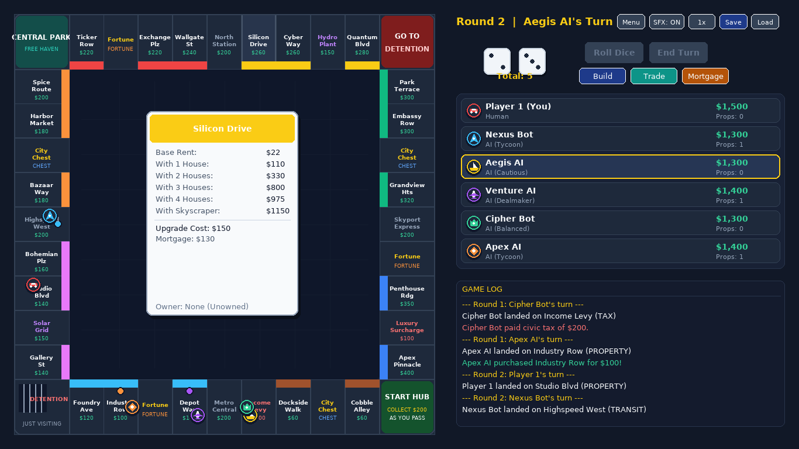

# Metro Tycoon (Monopoly Clone)

A modern, urban-themed Monopoly clone built in Python with Pygame. Play games against smart computer AI bots with up to 6 players!



---

## Features

- **Up to 6 Players**: Supports 2 to 6 players with any combination of human and computer AI players.
- **Distinct Metropolis Theme**: 8 vibrant city districts (Old Town, Warehouse District, Artisan Quarter, Market Ward, Financial Center, Tech Valley, Uptown Heights, and Crown Plaza) plus Transit Hubs and Utilities.
- **Smart AI Personalities**:
  - **Tycoon**: Highly aggressive builder who expands quickly and trades actively.
  - **Cautious**: Conservative player who maintains high cash reserves and avoids debt.
  - **Dealmaker**: Shrewd negotiator focused on completing color monopolies through trades.
  - **Balanced**: Well-rounded investor with steady growth.
- **Interactive Mechanics**:
  - **Property Auctions**: Unowned properties declined at printed price immediately go to open auction! All active players participate in turn-based round-robin bidding with quick bid buttons (+$10, +$25, +$50, +$100), AI tactical bidding with monopoly completion bonuses, and gavel audio effects.
  - **Trading**: Propose custom trades (properties + cash) with real-time AI evaluation and realistic counter-reasoning.
  - **Property Development**: Build houses (1-4) and skyscrapers (level 5) with even-building rule enforcement.
  - **Mortgage Management**: Mortgage properties for 50% value or unmortgage with 10% interest.
  - **Detention (Jail)**: 3 options to get out (roll doubles, pay $50, or use a Get Out of Jail Free card). Speeding penalties (3 consecutive doubles).
  - **Fortune & City Chest Decks**: Full 24-card card system with dividend payouts, repairs, grants, detentions, and movement.
- **Procedural Sound Synthesizer**: Zero external audio files required! Clean synthesized audio effects for dice rolls, cash registers, rent payments, card flips, jail clangs, wooden gavel taps, and victory fanfares.
- **Save & Resume**: Save match progress anytime to JSON and resume later.
- **Game Speed & Audio Toggles**: Switch between 1x and 3x game animation speed and mute/unmute audio on the fly.

---

## How to Play

### 1. Launch the Game
Activate the virtual environment and run `main.py`:
```bash
./venv/bin/python main.py
```
*(Or with your system Python if pygame-ce is installed: `python3 main.py`)*

### 2. Match Setup
- Select the number of players (2 to 6).
- For each player, customize:
  - Token design (Roadster, Shuttle, Yacht, Airship, Crown, Cyber Fox)
  - Control type: Human or AI Bot
  - AI Playstyle: Tycoon, Cautious, Dealmaker, or Balanced
- Click **Start Match** or choose **Quick Play (4 Players)** directly from the title screen.

### 3. Controls & Gameplay
- **Roll Dice**: Rolls two 3D animated dice. Rolling doubles gives you an extra roll!
- **Buy / Auction**: When landing on an unowned property, purchase it at list price or send it to open auction to bid against other players!
- **End Turn**: Passes turn to the next player.
- **Build**: Opens the development window to upgrade color monopolies.
- **Trade**: Opens the negotiation modal to propose trades with other players.
- **Mortgage**: Manage mortgages to raise emergency funds or restore properties.
- **Hover / Click**: Hover over any board tile to inspect its deed card (rents, mortgage value, building costs, and current owner).
- **Speed**: Click `Speed: 1x / 3x` in the header bar for fast AI turns.
- **Save**: Click `Save` in the header to save current match state to `savegame.json`.

---

## Project Structure

```
├── main.py              # Main game loop, states, animations, HUD
├── constants.py         # 40 board tiles, districts, decks, colors
├── board.py             # Board layout, tile rects, rent logic, rendering
├── player.py            # Player state, token shapes, financial metrics
├── cards.py             # Fortune and City Chest decks & card effects
├── ai.py                # AI decision engine (purchases, buildings, trades, auctions)
├── sound.py             # Procedural sound synthesizer using pygame.mixer
├── ui.py                # UI widgets (Buttons, EventLog, Panels, DeedCards)
├── modals.py            # Modals (Buy Property, Auction, Cards, Trade, Build, Mortgage)
├── save_manager.py      # Save & load serialization to JSON
├── screenshots/         # Captured screenshots of the game
├── tests/
│   ├── test_game.py     # Unit test suite (rules, rent, AI, cards, save)
│   ├── test_auction.py  # Auction test suite (bidding flow, AI valuation, monopolies)
│   ├── test_modal_scrolling.py # Modal viewport & interaction tests
│   └── test_render.py   # Headless screenshot verification script
└── requirements.txt     # Python dependencies
```
